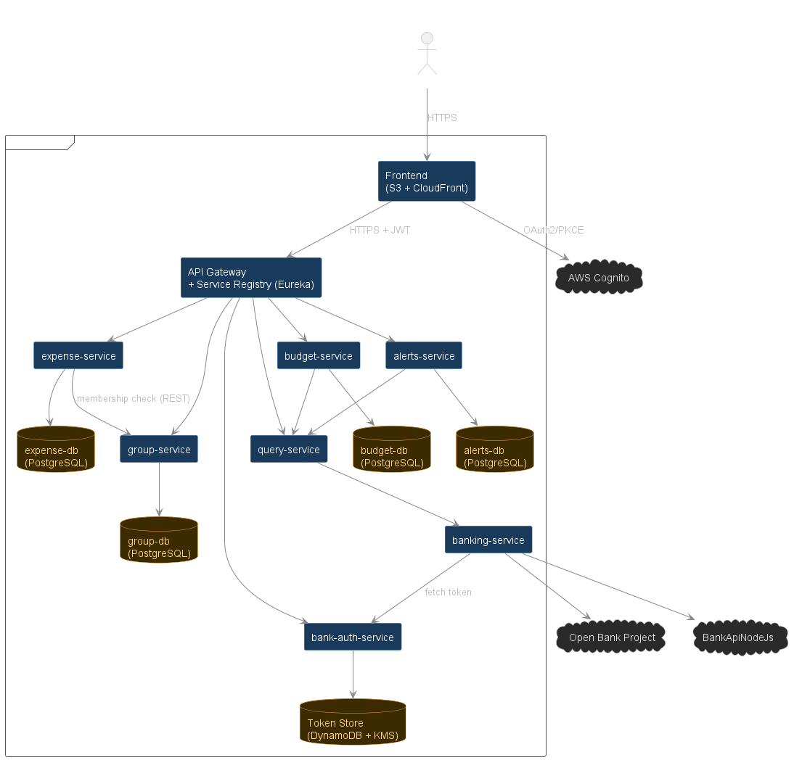
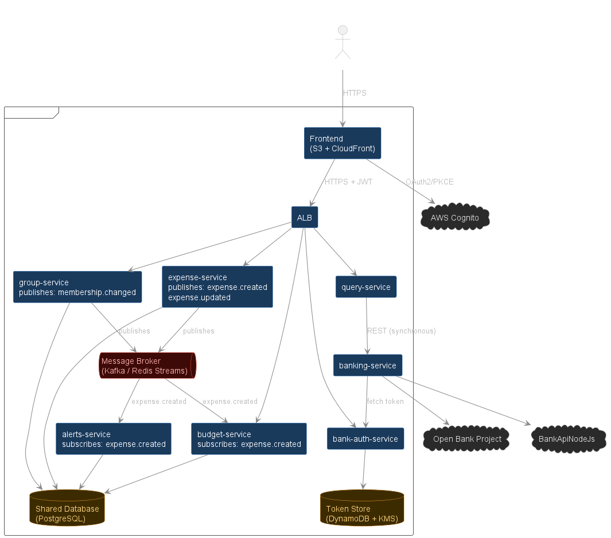
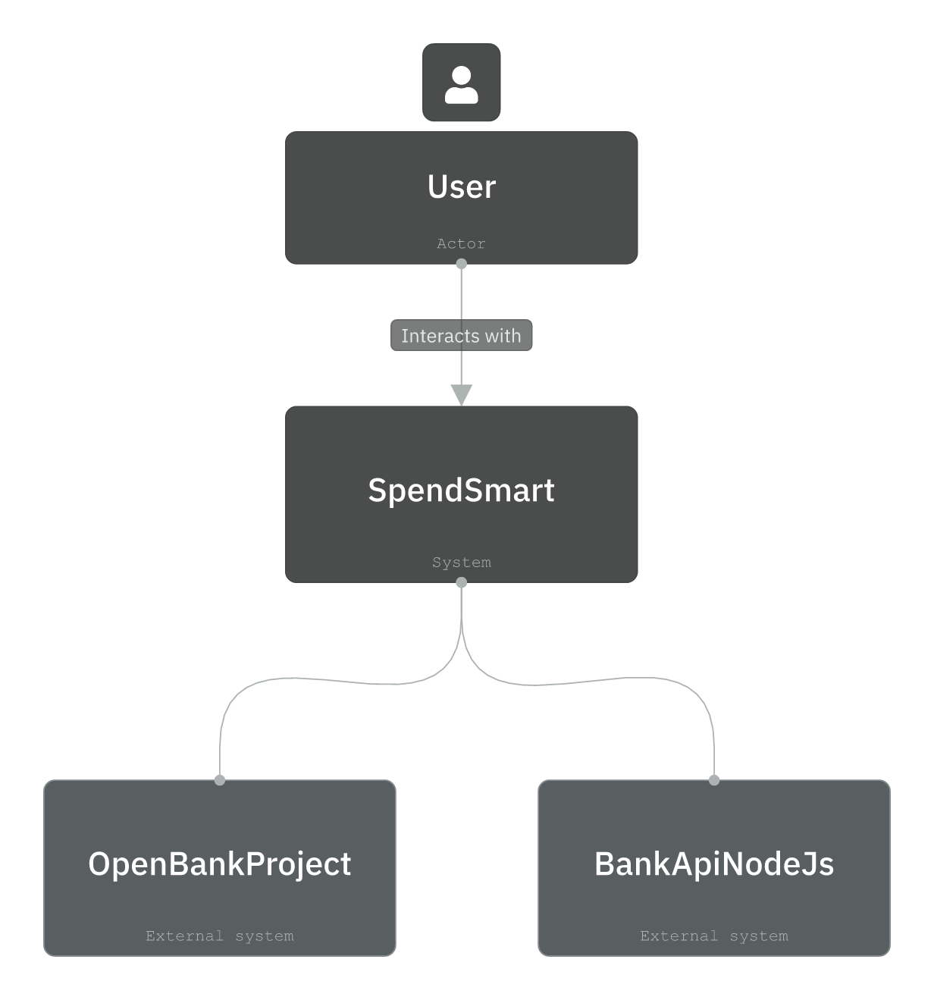
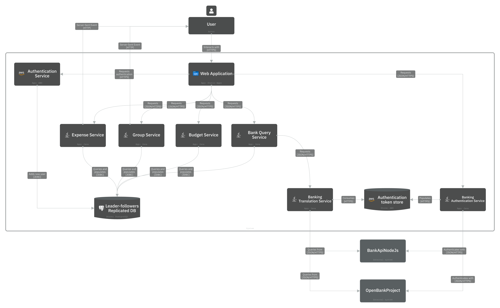
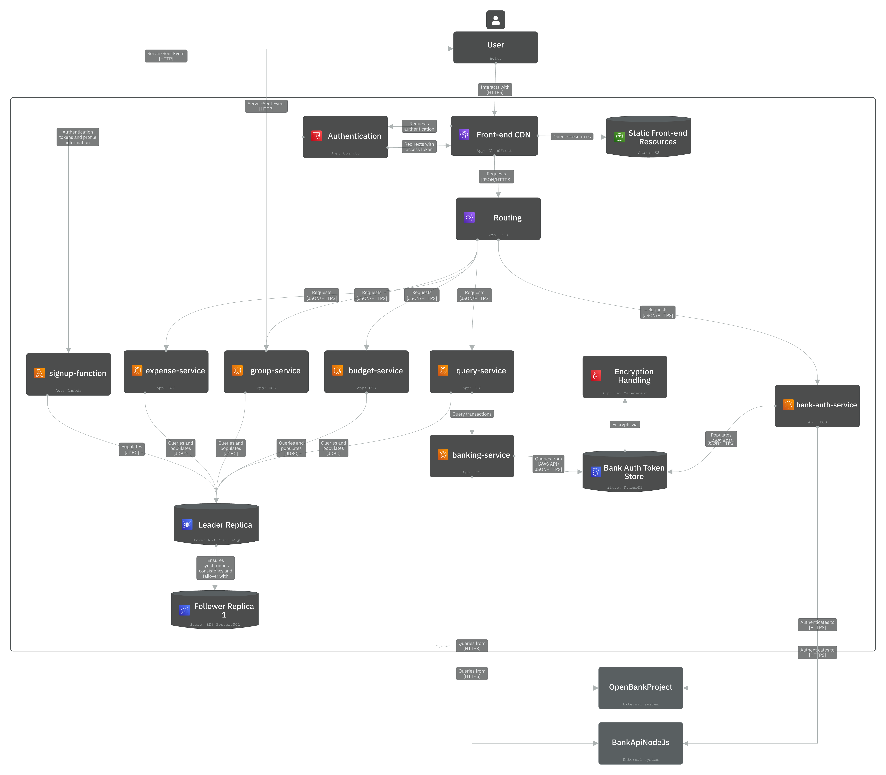
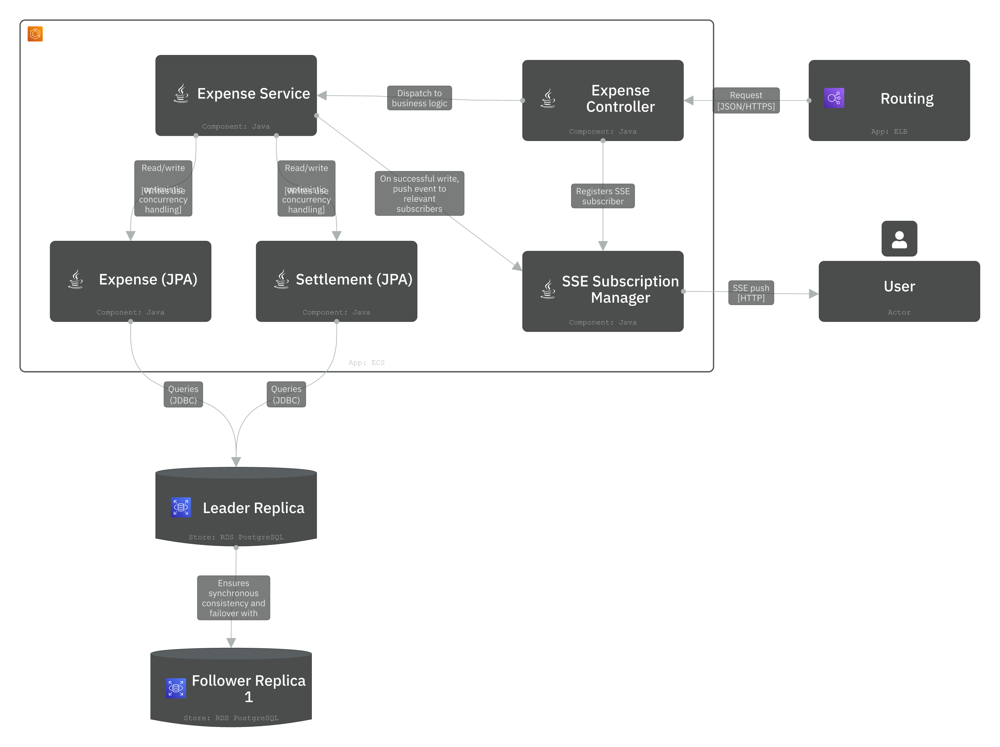
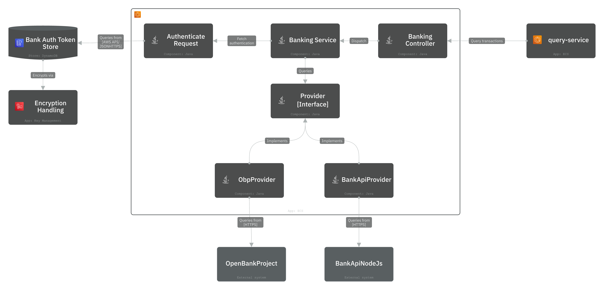

# Prac 4 SpendSmart Report
By
Abhinav Pradeep: 48039413,
Abhishek Bhattacharjee: 49016738,
Shivam Trivedi: 49016738,
Abdul Qadir Kallatra: 48935195,
Christo Kachappilly: 48010793,
Arush Shukla: 48096760


# 1.0 Abstract 

This report presents the architectural design, implementation decisions and evaluation of SpendSmart–a cloud-based expenses management platform designed to support collaborative financial tracking while securely integrating with external banking providers. The system was developed using a service-based architecture, with key design decisions driven by the project’s quality attributes of interoperability, reliability and security. This report outlines deviations from the original proposal, explaining how scope and implementation constraints influenced the final delivered functionality. It then examines the architectural options considered throughout development and justifies the selection of the final architecture. An evaluation of the final architecture is conducted against the project’s Architecturally Significant Requirements (ASRs), critically assessing the extent to which the system satisfies its intended functional and non-functional requirements while identifying opportunities for future improvements. The report concludes with a reflection on the software engineering lessons gained during the project, including the importance of validating architectural assumptions through implementation, documenting architectural decisions, and ensuring that architectural complexity remains aligned with clearly defined quality attributes. These reflections demonstrate how the experience of designing and implementing SpendSmart will inform future architectural decision-making and software development practices. 


# 2.0 Changes

## 2.1 Deliverable 1: Authentication Delegated to Cognito, Profile Management Not Implemented

Deliverable 1 specified a secure authentication system allowing users to register and manage profiles. AWS Cognito Hosted UI was used to satisfy the authentication requirement by handling user registration, login, email verification, and session token issuance. On first confirmation, a post confirmation Lambda creates a corresponding user record in the application database, linking the Cognito identity to the internal user model.

However, the profile management aspect of this deliverable was not implemented. The application does not provide an interface or endpoint through which users can update their name, email address, or password after registration. The user record stored in the application database is written once during sign up and is not subsequently editable through the application.

This was a deliberate scope decision. Profile management requires coordination between two systems: Cognito, which owns the credentials and identity attributes, and the application database, which stores the user record. It also introduces non trivial error handling for cases such as email change verification flows. Given that this coordination adds operational complexity without contributing directly to the core expense tracking functionality, it was deprioritised in favour of completing the banking integration, group expense management, and query features.

## 2.2 Deliverables 6 and 7: Alerting Replaced with Budget Versus Actual Dashboard

The proposal described two related deliverables focused on spending awareness. Deliverable 6 involved alerting logic that would use visual indicators to show changes in spending behaviour by comparing current spending with historical benchmarks. Deliverable 7 involved a state tracking feature that would monitor expenses against user defined budget thresholds and provide a real time view of remaining funds.

For Deliverable 7, all required backend functionality has been implemented. The alerts service includes database migrations for budget and alert tables, entity classes, DTOs, load balancer routing, and fully implemented service and controller methods. Users can define a budget by selecting a spending category, setting a monetary limit, and choosing either a weekly or monthly period. The backend then correctly tracks actual spending against that budget.

Due to time constraints and a miscommunication within the team, the frontend interface for this functionality was not completed in the final deployed version. The dashboard and budget input page do not include the JavaScript needed to connect the user interface to the backend. As a result, the feature is fully functional in the backend, but is not yet visible to users.

For Deliverable 6, the team designed an alerting solution based on Amazon Simple Email Service. This would have sent spending alerts to users by email when defined thresholds were crossed. The design for this integration was completed. However, the team did not have the required AWS permissions to use Amazon Simple Email Service in the project environment. For this reason, the feature was removed from scope. This was not due to a lack of planning or design work.

The historical benchmarking requirement from Deliverable 6 was also not carried forward for a separate reason. Meaningful comparisons between current spending and prior periods require enough transaction history across multiple periods to produce useful results. The mock banking dataset used in this project does not provide enough historical depth. Including this feature would therefore risk producing misleading results rather than useful insights.

A user defined threshold model, as described in Deliverable 7, was considered a more appropriate way to meet the underlying goal of improving spending awareness.


# 3.0 Architecture Options
Three architectural patterns were considered during development: full microservices, event-driven architecture (EDA), and service-based architecture (SBA). Rather than selecting one upfront, the team began with microservices, transitioned to
EDA, and ultimately landed on SBA as implementation exposed the costs of each earlier approach. Each pattern is described below alongside the reasoning that led the team away from it, or in the case of SBA, toward it.
## 3.1 Initial Microservices Idea



This was the team's starting point. As shown above, each service owns its own database, an API Gateway handles all inbound routing, and a service registry (Eureka) manages service discovery. The key detail to note is the arrow from
```expense-service``` to ```group-service```. This is checking whether a user belongs to a group before creating an expense requires a REST call across service boundaries, because expense-service has no access to group-db.

The appeal of this pattern is genuine. Each service fails independently, scales independently, and its schema changes cannot affect another service. For a system expected to grow, that isolation is valuable.

However, implementation revealed that these benefits came at a cost the project could not justify. The cross-service membership check means every expense write depends on a network call succeeding, which is adding latency and a new failure mode on
the critical path. More significantly, ASR-3 requires that concurrent expense updates are detected and rejected reliably. Across separate databases, this demands a distributed transaction strategy such as the saga pattern, which is
substantial added complexity for a reliability guarantee that a shared database provides trivially. On top of this, seven databases would need to be provisioned, migrated, and monitored, alongside the service registry and gateway
infrastructure required before any feature could run end-to-end.

The isolation microservices provides is good, but it only pays off at a scale SpendSmart does not operate at right now. So, the team moved on.

## 3.2 Coming up with an Event-driven Design


After stepping back from full microservices, the team explored EDA. As shown in figure X, services publish events to a central message broker (Kafka / Redis Streams), and downstream services such as budget-service and alerts-service subscribe
and react asynchronously. Worth noting in the diagram is what doesn't go through the broker. ```banking-service``` still calls ```bank-auth-service``` and the external providers synchronously, because fetching a live bank token cannot be deferred.
The pattern had good appeal, since adding a new consumer requires no changes to the producer, so having an alerts-service reacting to expense.created events was a natural fit for this model. Asynchronous processing also means the frontend does not wait on
downstream work like budget recalculation.

The problem is that eventual consistency is unsafe for a money application. A user could read a stale balance or trigger a budget alert against data that has not yet been committed, which conflicts directly with ASR-3. The optimistic
concurrency control used to prevent silent overwrites also becomes harder to reason about when updates can arrive out of order through a broker. Beyond consistency, the synchronous calls in the diagram expose a deeper issue, being that the banking
integration could never be made fully asynchronous, forcing a hybrid model that keeps all of the broker's operational complexity while losing some of its decoupling benefit. The team moved through Apache Kafka (which wasn't allowed), then Redis Streams, and a
Node-based job queue before concluding that none resolved these problems. 

It was also an overkill design for what we needed.

## 3.3 What we ended up choosing  
SBA was not a deliberate upfront choice, as it emerged from removing what the previous two patterns required that the system did not actually need. The full architecture is described in section 4, but the key structural differences from the
earlier options are worth naming here. Services still have clear boundaries and are independently deployable, retaining the modular benefit of microservices. However, they share a single PostgreSQL instance rather than each owning a database.
The membership check that required a cross-service REST call in the microservices design is now a direct database read, which is simpler, faster, and with no additional failure mode. There isn't any message brokers, and where services do need to communicate,
they do so over synchronous REST when necessary

# 4.0 Architecture

## 4.1 Overview

At a high level, SpendSmart is implemented as a service-based web application. Authentication is handled by Amazon's Cognito service. Static web pages are served through CloudFront + S3. These pages communicate to the services via JavaScript, with requests routing through an ALB. The backend is split into independently deployable containers for expense management, group management, budget management, banking integration, bank authentication, and transaction querying. Core application state is persisted in PostgreSQL RDS, deployed with Multi-AZ support for improved availability and managed failover. Authentication tokens for the banking integration are persisted in DynamoDB with at-rest encryption via KMS.

## 4.2 Context level (C1)



Users interact with SpendSmart, which itself must interact with OBP and BankApiNodeJS.

## 4.3 Container level (C2)



### 4.3.1 Description of key containers

| Service | Role|
| - |-|
| `expense-service`   | Owns expense management, settlement management, concurrency safety and SSE subscription and pushes.|
| `group-service`     | Owns group and membership management.|
| `budget-service`    | Owns budget management.|
| `bank-auth-service` | Handles authentication with banking providers and persisting obtained tokens.|
| `banking-service`   | Normalizes external transaction formats into SpendSmart’s internal representation.|
| `query-service`     | Queries the `banking-service`, expecting results in the internal representation. Is used by the dashboard and transaction search views.|


### 4.3.2 Justification of the split

The services are split by business responsibility rather than by technical layer. Each service owns a well-defined part of the SpendSmart domain. Each service was also given a strict contract to adhere to. This was done in an effort to allow for trivial parallelization of development work and ease of modification and testing.

## 4.4 Deployment view



This deployment view maps the logical containers onto AWS infrastructure. Static frontend assets are hosted in an `S3 bucket` and served through `CloudFront`. API requests are routed to an `ALB`, which forwards requests to the correct `ECS` service using path-based routing.

Backend services are packaged as `Docker` containers and pushed to `ECR`. Each service is deployed as an `ECS Fargate` instance with its own task definition, health check and `CloudWatch` logs. Core application data is stored in `PostgreSQL RDS`, while banking provider tokens are stored separately in `DynamoDB` and encrypted at rest using `KMS`.

## 4.5 Component level (for `banking-service` and `expense-service`)

Below are component level diagrams for key services. These allow for clarity of some of the more fine-grained detail. They also map into their code implementations to act as a guide for reading those sub-directories in the repository.

### 4.5.1 `expense-service`



Mapping this diagram to code (under `services/expense-service/src/main/java/com/spendmart/expense_service`):

  - The "Expense Controller" box stands for `ExpenseController`, `SettlementController`, and `ExpenseEventsController` in code.
  - Controllers dispatch into the service layer: drawn as the single "Expense Service" box, mapping into `ExpenseService` and `SettlementService` in code.
  - The services read/write the `Expense` and `Settlement` JPA entities using optimistic concurrency.
  - Writes/reads go over JDBC to the `RDS PostgreSQL` instance ("Leader Replica" box). The "Follower Replica 1" box represents the Multi-AZ synchronous standby.
  - The "SSE Subscription Manager" box represents `SseSubscriptionManager`, an in-memory registry of open SSE connections scoped at the group level (`Map<groupId, Map<subscriptionId, SseEmitter>>`).
  
### 4.5.2 `banking-service`



Mapping this diagram to code (under `services/banking-service/src/main/java/com/spendmart/banking_service`):

  - The "Banking Controller" box maps to `BankingController` in code. 
  - The "Banking Service" box maps to   `BankingService` in code.
  - The "Provider [Interface]" box represents the `BankProviderAdapter`. The "ObpProvider" / "BankApiProvider" boxes are its two implementations, `ObpAdapter` and `BankApiAdapter`.
  - The "Bank Auth Token Store" (DynamoDB) and "Encryption Handling" (KMS) boxes map to `bank-auth-service`'s storage layer: `TokenStore` reads/writes the bank-auth-tokens DynamoDB table, which is encrypted at rest by KMS.

## 4.6 External provider use in the MVP

### 4.6.1 BankAPINodeJS

We had to deploy this ourselves. `bank-api-nodejs` is deployed on ECS as a task that bundles its own database, rather than talking to an external database. This was the simplest way to deploy it. The task definition declares two containers that share one network namespace: a `mongo:6` container and the actual app container. Because they live in the same task under `awsvpc` networking they share a loopback interface. Hence the app reaches MongoDB over localhost. 

### 4.6.2 OBP

We were unable to get API keys for the public OBP sandbox due to issue on their website. Due to this, we attempted to build it from source and mock data. This did not work, and meant we had therefore could not demonstrate full interoperability. However, the interop layer exists, and with a functional OBP, we can seamlessly integrate with it.


# 5.0 Trade-Offs

Every choice we describe here was made with the scope of MVP in mind, which is an application for spend tracking. A lot of these calls would have gone the other way if we were building SpendSmart for thousands of real users or for years of maintenance. For each decision we try to say the same four things, namely what we chose, what we rejected, what it cost us, and which of our requirements it was serving.

The sections are orded to move from the largest decision down to the smaller ones. it begins with the overall shape of the system and how many services to split it into, since we changed our minds about that partway through and it is the single biggest trade-off we made. From there we cover how the services talk to each other and how they store their data, then how we integrate with external banks, then identity and security, and finally how we keep editing reliable and updates live. Where a decision exists to satisfy a specific architecturally significant requirement we name it, so the reasoning can be traced back to what the system was actually required to do.

## 5.1 The architecture style we chose

When we first sketched SpendSmart, the biggest decision was not which framework or which database, it was the overall shape of the system, and we genuinely weighed a few different shapes before settling on one.

The first option we looked at was a full microservice architecture. In this style each service owns its own database, never touches another service's data, and is deployed and scaled completely on its own. It is a strong pattern, but it is also a heavy one, because it means managing many databases, doing real work to keep data consistent across them, and accepting a lot of moving parts for the system.

The second option was an event driven architecture. Here services would not call each other directly but would publish events to a message broker, and any service that cared would subscribe and react in its own time. The draw was loose coupling and responsiveness, since a service does not need to know who is listening and the user is not left waiting on slow downstream work, and adding new behaviour later is easy because a new consumer just subscribes to events that already exist. We took it seriously enough to design around it and moved through Apache Kafka, then Redis Streams, and at one point a Node based job queue. The trouble we kept hitting is that an event backbone brings eventual consistency, where different services briefly disagree about the current state, and that is genuinely risky for a money app where a stale balance or a wrong budget alert actually matters. It also makes concurrent updates harder to get right than the simple version check we ended up using, and a failure spread across an asynchronous chain is harder to trace than a plain synchronous log. On top of all that the broker is real infrastructure to run, secure, and operate. The cost was certain and the benefits were ones we did not really need at our scale.

What we landed on sits between these two extremes, and it is called a service based architecture, or SBA. We still split the application into several independent services, each with a clear responsibility, and each can be built and deployed on its own, but unlike full microservices they share a single database, and unlike the event driven design they talk to each other over ordinary synchronous REST with no broker in between. In practice this gave us six application services, for expenses, groups, banking, bank authentication, querying, and alerts, sitting alongside BankApiNodeJs, a separate Node based banking API that we run ourselves and treat as one of the external bank providers in place of a real financial institution. This kept the parts of the microservice idea that genuinely helped us, which were clear module boundaries and independent deployability, while dropping the parts that only pay off at a much larger scale, which were per service databases and an asynchronous event backbone.

We want to be precise about what actually pointed to SBA, because some of the benefits people associate with it are really benefits of splitting the system into services, and those are shared by the full microservice and event driven options too.
What separated SBA from those two for us was how much complexity each one would leave us to manage. Set against full microservices, SBA keeps the independent services we wanted but lets them share a single database, so we did not have to run several databases and keep them consistent with one another for a system this small. Set against the event driven design, SBA has services talk over synchronous REST against shared, immediately consistent data, which is far simpler to build and to debug than a broker with eventual consistency and distributed conflict handling, and it is safer for a money app where the data has to agree at all times. The thread through both is that we wanted the system to stay simple enough for six people to actually manage and reason about, so we took the service independence that helped us and stopped short of the extra moving parts the other two styles would have added.

The trade we made by choosing SBA is genuine. We gave up the strong isolation that separate databases would have given us, and we gave up the loose coupling that a broker would have brought. What we got back was a system that we could build in parallel and finish on time, that fails in pieces rather than all at once. For a project of this size and timeline to build, we are confident that was the right balance.

## 5.2 How finely to split the services

Closely tied to the style decision is how many services to split the system into, and this is a trade-off in its own right rather than an obvious answer. We landed on six application services plus the separate bank API, rather than building one large application or a dozen tiny ones. Splitting the system this way let us divide the work cleanly across the team, gave each part a focused and smaller codebase, and let each service be deployed on its own. A single large application would have been simpler to deploy and to monitor and would have had no network hops between its parts, but it would also have been one big tangle that was harder to divide between people and harder to reason about in isolation, and a failure anywhere in it would have taken the whole thing down, which works against the reliability the system is meant to have.

The cost of more services is that each one needs its own deployment, its own configuration, and its own monitoring, and every call between them is one more hop that can be slow or fail. Pushing the split much further, into many tiny services, would have multiplied that overhead faster than it added value for a system our size. We chose six because it lines up with the natural boundaries in the problem, expenses, groups, banking, bank authentication, querying, and alerts, without slicing things so thin that managing the pieces becomes the main job. It is a judgement call rather than a rule, and we think it sits in a sensible middle ground.

## 5.3 Talking between services with plain REST

Following from the style decision, where services do need to reach across boundaries for data that is not in the shared database, they do so with plain synchronous REST. The clearest example is the query path: when the query service needs transaction data it calls the banking service over HTTP, and the banking service in turn calls bank-auth-service to retrieve the user's stored bank token before fetching live from the external provider. Data that already lives in the shared database, such as group membership, is read directly through the shared schema rather than going over a network hop, which is simpler and faster. There is no broker, no queue, and no event stream anywhere in the system.

The benefit of this approach is that cross-service calls are used only where they are genuinely needed, keeping the system easy to follow and trace. The path from a frontend request through to the external bank and back is a chain of direct synchronous calls with an immediate response at each step, rather than messages flowing through queues and arriving in unpredictable order. The cost we take on is a degree of temporal coupling on that call chain, since the caller needs the answer before it can continue and depends on the downstream service being reachable. We judged this an easy cost to carry, because the call chains are short and shallow and the dependencies are stable and well understood. The looser coupling a broker would buy is really aimed at much larger systems with many independent consumers, which is not the shape of our problem.

## 5.4 Sharing one database across the services

The microservice instinct is to give every service its own database so that no service can touch another's data and each can scale and fail on its own. We started down that path and quickly ended up planning six separate databases, which would have meant six instances to provision, migrate, back up, and keep an eye on, and the extra job of keeping data consistent across them. We pulled back and put all of the services on a single PostgreSQL instance instead. Because all services share this database through a common schema, they can read the data they need directly rather than going over a network hop for every lookup. The expense service, for example, reads group membership directly from the shared tables when it needs to check whether a user belongs to a group, rather than calling the group service over HTTP for that answer.

The win here is that there is far less to manage and reason about. There is one database to set up, one set of credentials, one backup, one schema, and one migration path, rather than that same work repeated six times and a separate problem of keeping the copies in step. For a small team that is a real reduction in moving parts. What we traded for it is physical isolation between services, since they share one instance and therefore one connection pool, which is a consideration at much larger scale but has little effect on a system of our size and load.

The way we think about this is that we kept the part of database isolation that actually protects the design, which is that each service still owns and is the only writer of its own tables, and we set aside the part that mainly adds operational complexity, which is running separate physical instances. The boundary between services is enforced by how we wrote the code rather than by the database itself, and because that ownership is kept clean, splitting the databases apart later would be a contained change rather than a rewrite.

## 5.5 Letting Cognito own identity

Our first authentication service signed its own tokens and stored its own users, which meant we owned password hashing, token signing secrets, expiry, and a users table. We replaced all of that with AWS Cognito and turned our own authentication layer into a thin wrapper. Cognito now handles registration, passwords, email verification, and token issuance, and the rest of our services simply validate the tokens it issues against its public keys.

The reason we made this change is security, plainly, and it serves our requirements for secure handling of financial data (ASR-5) and for controlling who can see what (ASR-6), since both rest on every request carrying a trustworthy identity. Authentication is one of the easiest things to get subtly wrong, and one mistake in token handling or password storage can expose real accounts. By handing this to a managed service that is built and maintained for exactly this purpose, we removed a whole category of risk from our own code, and we also got rid of the credential table from our database completely. The cost is that we now depend on AWS for a core part of the system, and the switch rippled through the whole codebase, because Cognito identifies each user with a string identifier rather than a number, so every entity, controller, and query that referenced a user had to be changed to use that string. Local development also became more awkward, since Cognito has no official offline version, so running the app away from AWS needs a small workaround.

We are comfortable with this trade. The risk we removed is the kind that causes real harm if it goes wrong, and the work we took on in exchange was mechanical and only had to be done once. For a team that could never give authentication the long term attention it deserves, owning less of this code is a clear improvement rather than a compromise.

## 5.6 Keeping the banking service stateless and reading live

We originally planned for the banking service to keep a local copy of each user's transactions in its own table and to sync that copy from the bank on a schedule. We removed that idea entirely. The banking service now holds no data of its own at all. On every request it authenticates with the bank, makes a live call, normalises whatever comes back into our own internal transaction shape, and returns it. The search, dashboard, and budget features all get their data by calling the banking service directly whenever they need it.

The benefit of this is simplicity and freshness at the same time. There is no banking database to run, no sync job that can fall behind or fail, and no deduplication to get right, and the data is always current because it comes straight from the source at the moment it is asked for. Because the service holds no state, we can also run more copies of it freely. The trade is that the features which read bank data depend on the bank being reachable and reasonably quick, since they read it live rather than from a local copy.

We were comfortable with this because, for a money app, a stale local cache would have been a worse problem than reading live, and because the adapter we placed around the bank means resilience measures such as caching can be added later behind that same interface without the services that call it having to change. Live and simple was the right starting point at our scale, and the design keeps the option to harden it open.

## 5.7 Supporting more than one bank behind a single adapter

This decision exists to satisfy our interoperability requirements directly, which are authenticating with different bank APIs and normalising their data (ASR-1), and supporting new providers with minimal rewriting (ASR-2). We wanted the system to be able to talk to more than one banking provider without rewriting the parts of the system that use bank data, and we handled this with an adapter pattern inside the banking service. Each provider has its own adapter that knows how to authenticate with that provider and how to translate its responses into one shared internal transaction format, and the rest of the system only ever sees that shared format. The design includes an adapter for the Open Bank Project sandbox and one for BankApiNodeJs, the Node based banking API we run ourselves. In practice the system runs on BankApiNodeJs, which is fully wired and deployed, while the OBP adapter exists in the codebase and is structured identically, but was not activated because we were unable to obtain the API credentials required to register with the OBP sandbox.

The value of the pattern is clear regardless: adding or swapping a provider is a contained job. A new bank means writing one new adapter that maps its data into our internal shape, and nothing downstream has to know or care. The fact that the OBP adapter exists and compiles alongside the BankApiNodeJs adapter, sharing the same interface and the same selection logic, is itself a demonstration of the extensibility the pattern gives us. The provider selection is decided in code rather than external configuration, which fits the small fixed set of providers we support and keeps that logic simple and easy to follow.

## 5.8 Pushing live updates with Server Sent Events

Our real-time requirement (ASR-4) asks that an update to a shared expense or group is reflected across everyone's session without anyone having to refresh. The clearest case is the shared expense view inside a group, where a change one member makes should appear for the others on its own. We handle this with Server Sent Events, which is a simple one way stream from the server to the browser over an ordinary HTTP connection, and the expense service pushes an event to a group's connected clients whenever an expense or settlement changes.

We chose this over two alternatives. The first was polling, where the browser would ask the server for updates every few seconds, which is easy but wasteful and always either too slow or too chatty. The second was WebSockets, which give a full two way channel and are the more powerful option, but are also heavier to run and more than we needed, because in our case the updates only ever flow from the server to the client. Server Sent Events sit nicely in the middle for our needs, and we built reconnection with exponential backoff into the client so that a dropped stream picks itself back up without the user noticing, and we did not have to add any new infrastructure to support it.

The cost is that the stream is one way, which suits us because these updates only ever flow from the server to the client. If a client briefly loses its stream it reconnects and reloads the current state on its own, and our optimistic concurrency control independently ensures that a save based on out of date data is rejected rather than allowed to overwrite newer changes. For the kind of updates we use it for, Server Sent Events were a clean fit.

## 5.9 Optimistic concurrency for shared edits

Because group expenses can be edited by more than one person, our reliability requirement (ASR-3) specifically asks us to keep the ledger correct when two people edit the same expense at the same time. Without any protection, whoever saves last silently wins and the earlier person's change just disappears, with nobody told. We prevented this with optimistic concurrency control, which means every expense carries a version number, and when someone saves, the system checks that the version they started from is still the current one. If someone else has saved in the meantime, the save is rejected with a conflict response instead of being allowed to overwrite the newer data, and the client is expected to reload and try again.

We chose this over pessimistic locking, where the system would lock the expense while one person edits it so that nobody else can. We did that because real conflicts here are rare. Most of the time two people are not editing the same expense at the same instant, and in that common case optimistic concurrency adds no waiting at all and holds no locks on the database, which keeps everything responsive. What it asks of the client in return is small and well understood, namely that when a conflict does happen the user is shown a clear conflict message and reloads the latest version before submitting again, which is a standard and familiar pattern.

For a workload that is mostly reading and only occasionally has two people writing at once, this was the right balance. It detects exactly the problem the requirement cares about, it needs almost no extra machinery because the framework supports it directly, and the reload and retry it asks of the client is a normal, well understood pattern.

Looking back across all of these decisions, the pattern is the same one each time. In nearly every case the more sophisticated option was available to us, whether that was a message broker, isolated databases per service, a local transaction cache, or full WebSockets, and in nearly every case we chose the simpler option on purpose, because the extra power only pays off at a very large scale and would have taken us more time to implement properly. We let the quality attributes and the real size of the system decide, not the appeal of the more advanced design, and we tried to keep our boundaries clean enough that the more sophisticated choices stay open to future updates rather than being closed off.


# 6.0 Critique

The previous section described the trade-offs we made during the design of this architecture. In this section I want to shift focus and ask a different question. How well does this architecture support delivering a more sophisticated and feature rich system?

## 6.1 Interoperability (ASR 1, 2)

The architecture uses an adapter pattern (ADR-004, ADR-008) to isolate external banking provider logic from the core banking service. The BankApiAdapter and ObpAdapter classes normalise OBP responses into an internal NormalisedTransaction schema. Adding a new provider requires implementing a new adapter class without modifying the core service logic. I believe this is a sound structural choice for a multi-provider banking integration.

However, we observed that the bank selection mechanism is hardcoded in the controller layer. Every new bank provider requires a change to the controller to route requests to the correct adapter. A config-driven approach like a provider registry or lookup table would allow new banks to be added without code changes. This would improve extensibility. We also find that the architecture couples the dashboard and alert services directly to OBP availability through synchronous REST calls (ADR-008). If OBP is unresponsive, both the dashboard and budget evaluation features become unavailable. For a more sophisticated system with multiple external providers, a cached fallback or circuit-breaker pattern would reduce this single point of failure risk.

## 6.2 Reliability (ASR 3, 4)

The system implements optimistic concurrency control through a version field on every expense entity. This is documented in ADR-007. It allows concurrent modifications to be detected without requiring pessimistic locks. This is appropriate for a multi-user expense management system where conflicts are expected but infrequent.

A significant weakness identified  is that the SSE (Server-Sent Events) mechanism does not handle disconnection gracefully. SSE is used to push updates to connected clients. If a client's SSE connection drops while the user is editing an expense, the client continues to work with stale data. The user may unknowingly overwrite a more recent server-side change. The optimistic concurrency control would detect the conflict on submission. However, the user experience is poor. The user only discovers the conflict at save time rather than being warned proactively. For a more sophisticated system, the client should re-fetch the latest expense state on SSE reconnect. Alternatively, the architecture could adopt WebSockets for bidirectional state synchronisation.

## 6.3 Security: Token Store (ASR 5)

Bank account credentials are stored on behalf of users in a DynamoDB-backed Token Store. These credentials are encrypted with KMS. The single-access-token design means each credential pair can only be read once. This limits exposure in the normal flow. I believe this provides a reasonable security baseline for a university project.

An critical weakness identified is that the Token Store itself is a single point of compromise. If an attacker gains access to the store, all stored bank credentials are exposed. Because the tokens represent the user's bank session, the attacker gains full access to the user's bank account. The architecture does not implement short lived tokens or require periodic re-authentication. Therefore, a compromised Token Store grants persistent access. For a more sophisticated system, it could be argued for token expiry with mandatory user re-authentication and a rotation mechanism. An audit log of token access events would also support breach detection.

## 6.4 Security: Authentication and Authorisation (ASR 6)

Authentication is handled by AWS Cognito (ADR-003). JWT tokens are validated against Cognito's JWKS endpoint using Spring Security's OAuth2 resource server. This removes the need for custom credential storage and password management. we consider this a security improvement over the initial custom-JWT design.

However, we noticed that the current approach to access control raises architectural questions about where authorisation logic should live. Each service is responsible for its own membership checks. The expense-service enforces group membership checks before returning or modifying data. The query-service reads the same transaction data for search and dashboard features. I observe that this kind of per-service authorisation is a valid architectural choice. It keeps each service self-contained and avoids a single point of failure in the authorisation path. But it also means that adding a new service requires reimplementing the same checks. An alternative would be to centralise access control at an API Gateway layer or through a shared authorisation library. This would reduce duplication across services. However, it would also introduce a dependency on the central authorisation component being available. Both approaches have trade-offs and the current design chooses service-level autonomy over central coordination.

## 6.5 Deployment and Service Boundaries (ASR 7)

All infrastructure is deployed on AWS using Terraform. This satisfies the platform constraint. The architecture uses a single shared PostgreSQL instance (ADR-002) rather than per-service databases. This simplifies provisioning and reduces cost. However, it means all services share the same connection pool and the same failure domain. If the database goes down, every service is affected simultaneously. An alternative would be per-service databases with independent connection pools. This would improve fault isolation and allow each service to scale its data layer independently. But it would also increase operational complexity and infrastructure cost.

Moreover, it is worth considering the service granularity. The current codebase contains six application services. Having more services means each team can own a smaller and more focused codebase. It also means services can be deployed and scaled independently. However, more services introduce additional operational overhead. Each service needs its own deployment pipeline, monitoring, and configuration. There are more network hops and more potential points of failure. Fewer services would simplify deployment and reduce operational burden. But each service would be larger and harder to reason about. The current six-service structure represents a reasonable point in this trade-off space. The team chose granularity over consolidation, and this is a valid architectural decision.


# 7.0 Evaluation

## 7.1 ASR-1 and ASR-2: Bank API Interoperability and Extensibility

The adapter pattern in `banking-service` isolates all provider-specific logic. Each adapter handles authentication with its provider and maps responses into the shared `NormalisedTransaction` format. Nothing outside `banking-service` knows which provider is in use. Adding a new bank means writing one adapter class, nothing else changes.

Two adapters were built: `BankApiAdapter` (deployed and active) and `ObpAdapter` (complete but not activated due to OBP credential issues). Both share the same interface and selection logic, which is itself evidence of the extensibility the pattern was designed to deliver.

`ObpAdapterTest` (`services/banking-service/src/test/.../adapter/`) covers normalisation in isolation — correct field mapping, the negative sign being stripped from debit amounts, an empty list when there are no transactions, and handling both ISO-8601 datetime and plain local date formats on `occurredAt`. `BankingServiceTest` (`services/banking-service/src/test/.../service/`) sits above that and tests the selection and fallback logic: the service picks the first adapter that has a stored token, falls back to the next if it does not, and returns empty when no bank is connected at all. This is the unit-level evidence that the service itself is provider-agnostic.

`BankingServiceIT` (`services/banking-service/src/test/.../service/`) then brings this together end-to-end against WireMock stubs, checking that field mapping is correct from a real OBP-shaped response, that a missing bank connection produces an empty list, and that an unreachable `bank-auth-service` returns a 503.

On the query side, `TransactionQueryServiceTest` (`services/query-service/src/test/.../service/`) confirms that normalised transactions filter correctly by provider, currency (case-insensitively), date range, and amount bounds. `SearchRequestValidatorTest` (`services/query-service/src/test/.../validation/`) covers the validation layer, rejecting inverted amount and date ranges before a query is even run.

ASR-1 is met for BankApiNodeJs. ASR-2 is met at the design level — the OBP adapter not running in production is an environment problem, not an architectural one.

## 7.2 ASR-3: Reliable Ledger Updates

Every `Expense` entity carries a `@Version` field. On every save, JPA checks that the stored version matches what the client last read. A mismatch returns HTTP 409, the client reloads and retries. This prevents silent overwrites without holding any database locks.

The key test is `updateFailsWhenVersionIsStale` in `ExpenseServiceValidationTests` (`services/expense-service/src/test/...`), which confirms that submitting an update with a stale version throws a conflict exception. The same class covers two other business rules: non-members cannot create expenses, and a split that does not sum to the total is rejected.

`SchemaConstraintTests` (`services/expense-service/src/test/...`) takes this down to the database level, running against a real PostgreSQL container via Testcontainers. It verifies that `externalTxnId` is unique per owner and provider, and that a user cannot hold more than one share entry on the same expense. These are the database-level guards that back up the application-level version check.

`GroupServiceIT` (`services/group-service/src/test/.../service/`) rounds this out by confirming that membership changes persist and that the group owner cannot be removed — an invariant the concurrency logic assumes to be stable.

ASR-3 is fully satisfied. Concurrent writes are detected and rejected rather than silently overwriting each other.

## 7.3 ASR-4: Real-Time Data View

The expense service maintains open SSE connections per group. After each successful write, it publishes an event to all connected clients for that group. The frontend subscribes on the expense list and detail pages, with exponential backoff reconnection if the stream drops.

Real-time behaviour was tested manually by running two browser sessions on the same group and confirming that a change made in one appeared in the other without a refresh. There is no automated controller-level test for the SSE subscription endpoint, and membership enforcement on that path relies on the same service-layer check that `GroupServiceIT` and `ExpenseServiceValidationTests` cover.

ASR-4 is satisfied for shared expense updates. The one known limitation is the stale-data window that opens if a client's SSE connection drops before it reconnects, though optimistic concurrency ensures nothing is silently lost during that gap.

## 7.4 ASR-5: Secure Handling of Financial Data

Authentication is delegated to Cognito, meaning no user passwords or credentials are stored in the application database. Bank tokens are persisted in DynamoDB with encryption at rest, and the application stores only what is strictly needed: user identity, expense amounts, and categories.

`TokenStoreIT` (`services/bank-auth-service/src/test/.../service/`) runs against a real DynamoDB Local container. It confirms that token storage and retrieval work correctly, that a missing key returns empty, and that a second write to the same key overwrites the first rather than accumulating stale entries.

ASR-5 is largely met. The known gap is that stored tokens carry no expiry, meaning a compromised token store would grant an attacker persistent access. Token expiry with mandatory re-authentication would close this.

## 7.5 ASR-6: Expense Access Control

Every request carries a Cognito JWT validated by Spring Security. The expense service checks active group membership on every operation using a direct query against the shared schema, and group mutations are restricted to the group owner.

Coverage spans three layers. `GroupServiceIT` (`services/group-service/src/test/.../service/`) runs against a real PostgreSQL container and verifies that a non-member receives HTTP 403 when reading a group, that membership changes persist to the database, and that the owner cannot be removed. `GroupServiceTest` (`services/group-service/src/test/.../service/`) covers the same owner-only rules at the unit level, confirming that adding members, removing members, and deleting a group all fail for non-owners with no write reaching the repository. `GroupControllerTest` (`services/group-service/src/test/.../controller/`) then checks the controller layer: a forbidden exception from the service becomes a 403 response, and any mutating endpoint without a valid JWT returns 401. `ExpenseServiceValidationTests` (`services/expense-service/src/test/...`) confirms that expense creation is rejected for non-members.

ASR-6 is fully satisfied. Every access boundary has test coverage at the relevant layer.

## 7.6 ASR-7: AWS Deployment

All infrastructure is defined in Terraform and deployed on AWS. Services run on ECS Fargate, the database is a Multi-AZ RDS PostgreSQL instance, tokens are in DynamoDB, Cognito handles authentication, and an ALB routes traffic by path to each service. A post-confirmation Lambda creates the application user record on Cognito signup.

The deployment was verified end-to-end. All services passed ALB health checks. User registration, Cognito login, bank provisioning, transaction retrieval, and group expense creation were all tested against the live deployment.

ASR-7 is fully satisfied.

## 7.7 Test Summary and Running the Tests
### Running the tests
Each service has its own Gradle wrapper. To run the tests for a given service, navigate to its directory and run:

```bash
./gradlew test
```

Docker must be running before executing any tests, as integration tests use Testcontainers to spin up real database containers (PostgreSQL, DynamoDB Local) and WireMock servers. HTML test reports are written to `build/reports/tests/test/index.html` inside each service directory.

### Test inventory
**`banking-service`**
- `ObpAdapterTest` *(Unit)* — OBP response normalisation and field mapping
- `BankingServiceTest` *(Unit)* — Adapter selection and fallback logic
- `BankingServiceIT` *(Integration, WireMock)* — Full chain: token fetch, adapter call, normalised response

**`bank-auth-service`**
- `TokenStoreIT` *(Integration, DynamoDB Local)* — Token put/get round-trip, missing key, overwrite

**`expense-service`**
- `ExpenseServiceValidationTests` *(Unit)* — Stale version rejection, non-member creation block, split validation
- `SchemaConstraintTests` *(Integration, PostgreSQL)* — DB-level uniqueness on `externalTxnId` and expense shares

**`group-service`**
- `GroupServiceTest` *(Unit)* — Owner-only mutations, membership state transitions
- `GroupServiceIT` *(Integration, PostgreSQL)* — End-to-end group lifecycle, 403 for non-members
- `GroupControllerTest` *(Web layer)* — JWT enforcement (401 without token), 403 propagation
- `SchemaConstraintTests` *(Integration, PostgreSQL)* — DB-level uniqueness of group membership records

**`query-service`**
- `TransactionQueryServiceTest` *(Unit)* — Filter by provider, currency, date range, amount bounds
- `SearchRequestValidatorTest` *(Unit)* — Search request validation (invalid date and amount ranges)

## 7.8 Mutation Testing

Line coverage shows that a test suite executes a piece of code, but it says nothing about whether the test actually checks the result. Mutation testing closes that gap: PIT, run through the `info.solidsoft.pitest` Gradle plugin, introduces small deliberate faults into the compiled code — flipping a conditional, changing an arithmetic operator, returning a different value — and re-runs the suite against each mutated version. A mutation that makes a test fail is "killed"; one that survives is a fault the suite would not notice in production. Test strength, the proportion of mutations killed among the lines the suite actually exercises, is therefore a stronger signal of test quality than line coverage alone, since it measures whether the assertions can catch real logic errors rather than just whether the code runs.

Mutation testing was run for each backend service with `./gradlew pitest`, producing the following results:

- **`group-service`** — 96% line coverage, 73% mutations killed, 79% test strength
- **`query-service`** — 48% line coverage, 46% mutations killed, 80% test strength
- **`banking-service`** — 50% line coverage, 39% mutations killed, 75% test strength
- **`expense-service`** — 50% line coverage, 38% mutations killed, 67% test strength
- **`budget-service`** — 31% line coverage, 43% mutations killed, 100%* test strength

Test strength averaged in the 75-80% range across the five services, meaning the suites caught roughly three in every four logic mutations introduced into the code they cover. `group-service` led the group on line coverage at 96%, which lines up with the breadth of `GroupServiceTest`, `GroupServiceIT`, `GroupControllerTest`, and `SchemaConstraintTests` listed in section 7.7. The lower line coverage figures elsewhere — `banking-service` and `expense-service` around 50%, `budget-service` at 31% — largely correspond to controller and configuration classes that sit outside unit test scope and are instead exercised through the integration tests and manual deployment checks described in sections 7.1 to 7.6. `budget-service`'s 100% test strength is marked with an asterisk because it is computed over a small number of covered mutations given its low line coverage, so it should be read as a promising sign rather than a conclusive one.

The exercise also showed where line coverage alone is misleading: `query-service` and `banking-service` both sit around 50% line coverage but reach a noticeably higher test strength (80% and 75%) than that figure suggests, which means the tests that do exist are checking outcomes rather than just executing code. Looking back, mutation testing is something the team would have benefited from running earlier in the project — introducing it alongside the suites as they were written, rather than as a final check, would have surfaced weak assertions while there was still time to strengthen them.


# 8.0 Reflection
## 8.1 Architectural Decisions Being Validated Through Implementation

One of the biggest lessons our team learned throughout the project was that architectural decisions should be treated as ‘hypotheses’ that should be validated through implementation rather than assumptions that remain fixed throughout development. During the initial design phase, the team selected event-driven architecture because it appeared to offer flexibility and greater scalability for integrating multiple services. At the time, this seemed appropriate given the project’s requirement to interact with an external banking provider and synchronise financial information across users.

However, as implementation progressed, we discovered that the complexity of the event-driven architecture exceeded the needs of the system. The project’s quality attributes (reliability, security etc.) did not require the additional complexity associated with an event-driven design. As a result, the team transitioned to a service-based architecture that better aligned with the system’s requirements. This change required multiple revisions to the architectural design, including updates to our IcePanel diagrams and refactoring the codebase/services. Although this introduced additional work–it ultimately resulted in a simpler and more maintainable architecture that was easier to reason about and test. 

Reflecting on this experience, a key lesson was that architectural complexity should only be introduced when justified by defined requirements. In future projects, the team would invest in validating architectural assumptions through proof-of-concept implementations and architectural spikes before committing to a system-wide design. This would allow potential issues to be identified earlier and reduce the risk of architectural rework later (reducing sacrificial architecture/architectural debt) later in the project lifecycle.

Applying this would likely improve future projects by minimising unnecessary refactoring and ensuring that architectural decisions remain closely aligned with both non-functional and functional requirements. The final service-based architecture ultimately demonstrated that simplicity can be a strength when it effectively delivers the required quality attribute objectives without introducing unnecessary complexity. 

## 8.2 Architectural Decisions Should be Documented
A second lesson learnt throughout the project was the importance of documenting architectural decisions and maintaining a clear record of why changes were made. While the team maintained architectural diagrams using IcePanel; these diagrams primarily captured the current state of the architecture–rather than the reasoning behind architectural decisions. As the system evolved from an event-driven to a service-based architecture, much of the rationale for these changes was communicated informally through meetings, messages, and discussions, rather than being captured in a central location. 

This became particularly evident during periods of refactoring, where understanding why an architectural decision had originally been made was often as important as understanding the design itself. Although updated diagrams accurately represented the final architecture, they did not provide historical context regarding the trade-offs considered or the reasons certain architectural approaches were abandoned. Consequently, architectural knowledge became dependent on individuals involved in the decision-making process rather than being embedded within project documentation.

Reflecting on this experience, the team learned that architecture is not solely defined by components, services, and interactions, but also by the constraints and decisions that shape those elements. In future projects, the team would introduce Architecture Decision Records (ADRs) and maintain a dedicated architecture wiki to document significant design decisions, alternatives considered, associated trade-offs, and the reasons for selecting a particular solution. This would create a permanent record of architectural knowledge and allow future developers to understand not only how the system works, but why it was designed in a particular way.

Applying this lesson would improve maintainability and reduce the risk of knowledge loss as projects evolve. It would also support future architectural changes by providing a clear history of previous decisions and their outcomes. For systems such as SpendSmar, where reliability, security, and interoperability requirements influence architectural choices, documenting decision rationale would improve traceability between the architectural mechanisms and quality attributes used to satisfy them. This would help ensure that future design changes remain aligned with the system’s non-functional and functional requirements.

## 8.3 Quality Attributes Should Drive Architectural Trade-offs

A final lesson learnt from the project was that architectural decisions should always be justified by the system’s quality attributes and the trade-offs required to achieve them. While functional requirements–in particular, interoperability, reliability, security, and maintainability, that had the greatest influence on the final architecture. 

One example of this was the implementation of optimistic concurrency control, which was an architectural decision motivated by quality attributes rather than functionality. Since multiple users can interact with shared expenses, the system needed a mechanism to prevent conflicting updates without introducing excessive locking. Optimistic concurrency provided a practical balance between scalability and consistency, ensuring that concurrent modifications could be detected while maintaining a responsive user experience.

The project also highlighted that quality attributes often compete with each other, requiring careful trade-offs rather than absolute optimisation. For example, improving interoperability through service independence and duplicated data can reduce coupling but also introduce challenges around data consistency. Moreover, increasing reliability through concurrency controls adds implementation complexity that must be justified by the likelihood and impact of conflicting operations. These decisions demonstrated that architecture is fundamentally about balancing competing concerns rather than maximising a single attribute.

Reflecting on this experience, the team realised that architectural patterns and technologies should not be selected simply because they are considered technically sophisticated. Instead, each decision should be traceable to a specific quality attribute and evaluated against the costs it introduces elsewhere in the system. In future projects, the team would place greater emphasis on explicitly documenting these trade-offs during the design process, ensuring that architectural complexity is only introduced when it provides measurable value.

Overall, this lesson reinforced that successful software architecture is achieved not by pursuing the most advanced design, but by making deliberate, evidence-based decisions that balance quality attributes and produce a reliable, secure and maintainable system that is suitable for its purpose. 

Ultimately, reflecting on these experiences overall, the team would place greater emphasis on early architectural validation and documenting design rationale. Applying these lessons in future projects would reduce architectural debt, improve maintainability, and help ensure that system designs remain closely aligned with their intended quality objectives. 